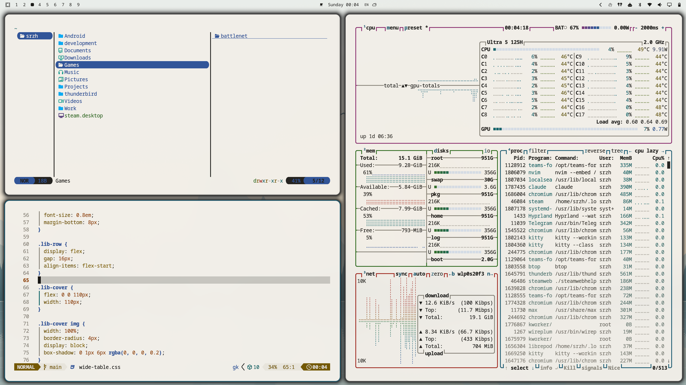

# Clarity — an Omarchy theme for astigmatism

A light [Omarchy](https://omarchy.org) theme designed to keep text sharp for people with astigmatism.



## Install

In the Omarchy menu choose **Install > Style > Theme** and paste:

```
https://github.com/88srzh/omarchy-clarity-theme
```

or from a terminal:

```
omarchy theme install https://github.com/88srzh/omarchy-clarity-theme
```

## Why it looks like this

- **Dark text on a light background.** Light text on a dark background tends to bloom and smear with astigmatism: the pupil opens wider on a dark screen and the eye's distortions grow. Dark-on-light reads crisper.
- **Warm off-white instead of pure white** (`#F2EFE8`) to cut glare and halos around letters.
- **Near-black text** (`#1C1B19`) — about 15:1 contrast with the background.
- **Muted, darker accents.** Saturated reds and blues focus at different depths in the eye and blur the most. Every palette colour keeps at least 4.5:1 contrast with the background (WCAG AA); most are 5.5–8:1.
- **Deep teal accent** (`#1A5A70`) — green-blue hues sit near the eye's sharpest focus.
- **Calm wallpapers** with large shapes and no fine repeating patterns, which shimmer for astigmatic eyes.

Tip: a slightly larger and heavier font (**Style > Font**) helps even more — thin strokes are the first to blur.

## Palette

| Role | Colour | Contrast on background |
| --- | --- | --- |
| background | `#F2EFE8` | — |
| foreground | `#1C1B19` | 15.0 |
| accent | `#1A5A70` | 6.7 |
| red | `#A12A20` | 6.4 |
| orange | `#94470C` | 5.8 |
| yellow | `#735600` | 6.0 |
| green | `#2E6A1F` | 5.7 |
| cyan | `#0B6266` | 6.2 |
| blue | `#2A4F96` | 6.9 |
| magenta | `#8A2D6E` | 6.8 |

## Wallpapers

The lake and hills wallpapers are original, 3840×2160, drawn procedurally.

`3-omarchy.png` is the Omarchy wordmark from the [Omarchy](https://github.com/omacom/omarchy) themes (MIT), recoloured to the Clarity accent `#1A5A70` on the theme background.

## License

MIT
